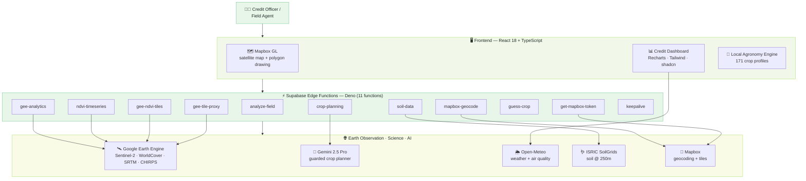
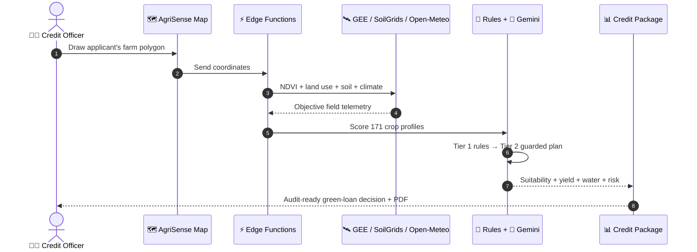
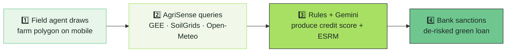

<div align="center">


# 🌾 AgriSense

### De-Risking Green Agricultural Credit — from orbit.

**Satellite telemetry, soil science, and climate analytics turned into pre-sanction credit intelligence for green lending.**

[](https://github.com/agrisense-dev/AgriSense)
[](#-battleverse-2026-alignment)
[](#-battleverse-2026-alignment)
[](LICENSE)

<br>

[](https://react.dev)
[](https://www.typescriptlang.org)
[](https://vite.dev)
[](https://tailwindcss.com)
[](https://deno.com)
[](https://www.mapbox.com)
[](https://supabase.com)
[](https://earthengine.google.com)
[](https://deepmind.google/technologies/gemini)
[](https://sentinels.copernicus.eu)

<br>

> 💡 **One idea:** *A bank should be able to draw a farm on a map and get a de-risked, audit-ready green loan decision in under three minutes.*

</div>

---

## 🎯 The Core Question

> **How can AI make climate-finance systems smarter and more predictive?**

Pakistan's lenders are under a **regulatory mandate** to scale green agricultural credit — yet they have **no field-level data** to underwrite it. AgriSense closes that gap.

It converts a single field polygon into the objective telemetry a credit officer needs before sanctioning a green loan:

| Question a lender must answer pre-sanction | AgriSense answers it with |
|---|---|
| 🌱 Is this land suited for the proposed crop? | Deterministic agronomy engine vs. soil, climate, land cover |
| 💧 Will this loan worsen water stress? | Historical water balance + evapotranspiration |
| 📈 What is the projected financial yield? | Telemetry-backed revenue & water-savings model |
| ⚠️ What is the climate risk over the loan tenure? | Multi-year NDVI baseline + climate shock signals |
| 📋 Does it meet SBP green-finance rules? | Automated Pakistan Green Taxonomy alignment |

---

## 🌍 The Problem — An Information Asymmetry in Green Lending

Pakistan sits at the sharp end of climate risk — ranked among the **most climate-vulnerable nations on Earth**, swinging between multi-year droughts and catastrophic monsoon floods. These shocks transmit straight into the **financial system** as surging Non-Performing Loans across agricultural portfolios.

- 💸 **Lenders must grow green credit, blindfolded.** Regulators push for expanded green agricultural portfolios, but credit officers have no empirical, field-level pre-sanction data.
- 🧾 **Underwriting is manual, slow, and unverifiable.** Site visits cost PKR 5,000–15,000 each and take **14–21 days** — with zero post-disbursement telemetry.
- 🌊 **Climate shocks are correlated.** When drought or flood hits a cluster, whole borrower groups default together — social-collateral models collapse.
- 🛰️ **The data exists — but not where lenders can use it.** NDVI, soil chemistry, and climate history live in scientist-grade tools, not in a loan-origination system.

> Without automated pre-sanction telemetry, financial institutions cannot scale green lending without absorbing unquantified default risk.

---

## 💡 The Solution — Satellite-Powered Credit Intelligence

**AgriSense is an automated, satellite-powered credit intelligence engine.** A credit officer or field agent draws the applicant's farm polygon on a mobile device; within seconds the platform returns a **green-loan suitability package**.

<table>
<tr>
<td width="50%">

### 🛰️ What it does

- 🗺️ Draw the farm polygon on a live satellite map
- 🌿 Read multi-year vegetation health (Sentinel-2 NDVI)
- 🪱 Profile soil — pH, organic carbon, nitrogen, CEC, texture, water retention
- 🌦️ Rebuild the season — rainfall, temperature, ET₀, air quality
- 🏞️ Classify land use + score agronomic suitability
- 🧠 Score **171 crop profiles** with a deterministic rules engine
- 🤖 Let Gemini 2.5 Pro plan only *after* rules decide what is sensible
- 📄 Export an audit-ready field plan as a PDF

</td>
<td width="50%">

### 🏆 Why it wins this track

- 🎯 **Financial target system** — every output is a credit metric
- ⚡ **Under 3 minutes** vs. 14–21 days manual underwriting
- 🔍 **Explainable by design** — rules first, AI second
- 🛡️ **Audit-ready** — maps to SBP ESRM & Green Taxonomy
- 📉 **Directly lowers Expected Loss** (PD & LGD)
- 🌐 **Global coverage** — works anywhere on Earth
- 📱 **Mobile-first** — built for the field agent, not the desk

</td>
</tr>
</table>

---

## ⚙️ The Dual Engine — Explainable AI for Credit Decisions

A credit decision cannot be a hallucination. AgriSense separates **deterministic reasoning** from **generative explanation** — the AI is only allowed to speak once the agronomy rules have approved what is sensible.

```mermaid
flowchart LR
    A["🛰️ Field signals<br/>NDVI · soil · climate · land cover"]
    B["🧠 Tier 1 — Deterministic<br/>Agronomy Rules Engine<br/>171 crop profiles scored"]
    C["✅ Valid crop set<br/>(edge cases rejected)"]
    D["🤖 Tier 2 — Generative<br/>Gemini 2.5 Pro<br/>zones · rotation · calendar · tips"]
    E["🛡️ Guardrails re-check<br/>reject out-of-set advice"]
    F["📊 Credit intelligence package<br/>suitability · yield · water · risk"]

    A --> B --> C --> D --> E --> F

    style A fill:#E8F5E9,stroke:#6FC78F,color:#1C2A24
    style B fill:#A8E063,stroke:#1C2A24,color:#1C2A24
    style C fill:#E8F5E9,stroke:#6FC78F,color:#1C2A24
    style D fill:#D9B84C,stroke:#1C2A24,color:#1C2A24
    style E fill:#A8E063,stroke:#1C2A24,color:#1C2A24
    style F fill:#6FC78F,stroke:#1C2A24,color:#1C2A24
```



| Engine | Job | Why a lender cares |
|:------:|-----|--------------------|
| 🧠 **Rules first** | Scores 171 crop profiles against soil, climate, water, land use, terrain | Fast, explainable, hard to fool — no black box in underwriting |
| 🤖 **AI second** | Gemini 2.5 Pro turns approved candidates into zones, rotation, calendar, tips | Human-readable planning a credit officer can act on |
| 🛡️ **Guardrails always** | Rejects wrong crop / wrong climate / altitude / land cover | Trust is a product feature in financial decisioning |

> **The wow factor isn't "we used AI."** It's AI that must pass agronomy before it is allowed to speak.

---

## 🏗️ System Architecture



### 🔄 From field polygon to credit decision



---

## 📸 Demo — One Real Field

> A walkthrough on a **9.1-acre wheat farm in Lahore, Pakistan.**

<table>
<tr>
<td width="50%"></td>
<td width="50%"></td>
</tr>
<tr>
<td align="center"><b>🖊️ Draw the field</b><br>One polygon. That's all it takes.</td>
<td align="center"><b>🌦️ Climate history, instantly</b><br>Rain, temperature, evapotranspiration — a full year.</td>
</tr>
<tr>
<td width="50%"></td>
<td width="50%"></td>
</tr>
<tr>
<td align="center"><b>📊 Full analytics dashboard</b><br>NDVI, land use, suitability, air & water quality.</td>
<td align="center"><b>🤖 Guarded crop plan, on the map</b><br>Every dot is a plant — placed by rules, explained by AI.</td>
</tr>
<tr>
<td width="50%"></td>
<td width="50%"></td>
</tr>
<tr>
<td align="center"><b>🥧 Zone allocation + impact</b><br>Wheat 35% · Walnut 33% · Maize 32% → 26% water saved, +24% revenue.</td>
<td align="center"><b>📅 3-season calendar + tips</b><br>Spring, summer, autumn/winter — planned with expert advice.</td>
</tr>
</table>

---

## 💰 Financial Impact — De-Risked Underwriting

Credit risk is quantified through the **Expected Loss** formula:

```
EL = PD × LGD × EAD
```

- 📉 **Lowers PD** — replacing unsuited monoculture with agronomy-matched crops raises projected net farm revenue by **+24%**, strengthening repayment capacity.
- 💧 **Lowers PD further** — a **26%** cut in water use lowers pumping energy costs, preserving farmer liquidity through dry spells.
- 🛡️ **Lowers LGD** — verifiable satellite asset proof enables early intervention (NDVI alerts) before total crop failure.

### Manual vs. Telemetry-Backed Underwriting

| Underwriting metric | 🧾 Traditional | 🛰️ AgriSense | 📈 Portfolio impact |
|---|---|---|---|
| Pre-sanction processing time | 14–21 days | **< 3 minutes** | ~98% faster origination |
| Field verification cost | PKR 5,000–15,000 / visit | Near-zero marginal cost | Lower operating expenditure |
| Environmental risk assessment | Subjective self-reporting | **Objective telemetry** | SBP ESRM ESDD compliant |
| Climate-shock resilience | High, unmonitored | Predictive stress alerts | Lower Portfolio-at-Risk |
| Regulatory alignment | Manual reporting | **Automated Taxonomy mapping** | Audit-ready |
| Expected Loss (EL) | Unmitigated baseline | De-risked baseline | Stronger Capital Adequacy |

---

## 📋 Regulatory Alignment — Built for Pakistan's Green-Finance Mandate

AgriSense is engineered against the **State Bank of Pakistan's** sustainable-finance directives:

| Directive | What it requires | How AgriSense delivers |
|---|---|---|
| 🟢 **Green Banking Guidelines** | Environmental risk in credit underwriting | Telemetry-based pre-sanction assessment |
| 🧾 **ESRM Implementation Manual** | Quantitative environmental risk ratings | Automated field-level risk scoring |
| 🌿 **Pakistan Green Taxonomy** | Science-based classification, anti-greenwashing | Objective land-use & crop classification |
| 🌡️ **Climate Risk Management Framework** | Climate risk integration, time-bound plans | Multi-year climate + NDVI baselines |
| 📊 **Climate Stress Testing Guidelines** | Physical & transition risk scenarios | Field-level exposure signals |

---

## ✨ Core Capabilities

### 🛰️ Satellite Field Mapping
- Interactive Mapbox GL satellite map with polygon drawing
- Live NDVI overlay from Google Earth Engine
- Auto-detection of rural vs. urban regions
- Fly-to animations, region search, side-by-side field comparison

### 🌿 Vegetation Health (Sentinel-2 NDVI @ 10m)

```
NDVI = (NIR − Red) / (NIR + Red)
```

| NDVI | Meaning | Status |
|-----:|---------|:------:|
| `< 0.2` | Bare soil / critical | 🔴 |
| `0.2 – 0.4` | Stressed | 🟠 |
| `0.4 – 0.6` | Moderate | 🟡 |
| `> 0.6` | Healthy | 🟢 |

### 🪱 Soil Science (ISRIC SoilGrids, 250m)
Full pedological profile — pH, organic carbon, total nitrogen, CEC, bulk density, sand/silt/clay texture, field capacity, and wilting point — visualized for underwriting.

### 🏞️ Land Use + Suitability
ESA WorldCover 10m classification plus a 6-axis suitability radar: soil, water, climate, topography, drainage, nutrients.

### 🤖 Guarded Crop Planning
- **Deterministic engine** — **171 crop profiles** across 12 categories scored instantly against the field's signals.
- **Gemini 2.5 Pro planner** — zone allocation, intercropping, rotation, and expert tips, constrained by Tier-1 rules.
- **Visual plan** — every crop is a dot on the real field; trees get bigger dots; filter by crop.

### 🛡️ Smart Edge-Case Detection
We don't plan crops on a lake. Or a glacier.

| Blocked when | Threshold |
|--------------|-----------|
| 🌊 Water bodies | ≥ 80% water (WorldCover) |
| 🏜️ Extreme aridity | < 50 mm annual rain (CHIRPS) |
| ❄️ Polar | > 66° latitude |
| ⛰️ High altitude | > 5,000 m elevation |
| 🏙️ Urban | ≥ 30% built-up → switches to urban mode |

---

## 🧰 Tech Stack

| Layer | Tech | Why |
|------|------|-----|
| 🖥️ **Frontend** | React 18 · TypeScript 5 · Vite 5 | Type-safe and fast |
| 🎨 **UI** | Tailwind CSS 3 · shadcn/ui · Radix | Beautiful + accessible |
| 🗺️ **Mapping** | Mapbox GL JS 3 | Smooth satellite rendering |
| 📊 **Charts** | Recharts | NDVI, climate, soil, suitability visuals |
| 🔄 **State** | TanStack React Query 5 | Smart caching, offline-friendly |
| ⚡ **Backend** | Supabase Edge Functions (Deno) | Serverless, low latency |
| 🛰️ **Satellite** | Google Earth Engine | Sentinel-2 · ESA WorldCover · SRTM · CHIRPS |
| 🤖 **AI** | Gemini 2.5 Pro | Guarded, context-aware crop planning |
| 🌦️ **Weather** | Open-Meteo | Forecast + 1-year archive + air quality |
| 🪱 **Soil** | ISRIC SoilGrids | Global soil @ 250m |
| 📄 **Export** | jsPDF | One-click audit-ready PDF |

---

## 📁 Project Structure

```
AgriSense/
├── 🖥️ src/
│   ├── components/        # MapView · FieldDetailView · CropPlanningSection · WeatherView
│   │   └── ui/            # shadcn/ui primitives
│   ├── data/              # 171 crop profiles · field types
│   ├── hooks/             # mobile · swipe · toast
│   ├── lib/               # language · backend callers · cache
│   ├── pages/             # Index · NotFound
│   └── integrations/      # supabase client
├── ⚡ supabase/functions/ # 11 Deno edge functions
├── 🌐 api/                # serverless API endpoints
├── 🎨 public/             # logo · favicons · demo screenshots
└── 🗄️ supabase/migrations/# database schema
```

---

## 🚀 Getting Started

### 1️⃣ Clone & install

```bash
git clone https://github.com/agrisense-dev/AgriSense.git
cd AgriSense
npm install
```

### 2️⃣ Configure secrets

```env
MAPBOX_TOKEN=               # Mapbox map + geocoding
GEE_SERVICE_ACCOUNT_JSON=   # Google Earth Engine service-account key
GEE_PROJECT_ID=             # GCP project with Earth Engine enabled
GEMINI_API_KEY=             # Gemini 2.5 Pro
```

> 🆓 **Open-Meteo** and **ISRIC SoilGrids** are free public APIs — no key needed.

### 3️⃣ Run

```bash
npm run dev                # frontend
supabase functions serve   # edge functions
```

Open `http://localhost:5173` → draw a field → get your credit intelligence package.

---

## 🌱 Impact — Green Finance Meets the Earth

| UN SDG | How AgriSense helps |
|--------|---------------------|
| 🎯 **SDG 2** — Zero Hunger | Higher yields through rules-validated crop choices |
| 💧 **SDG 6** — Clean Water | 26% water savings in the sample plan |
| 🌍 **SDG 13** — Climate Action | Climate-resilient rotation planning |
| 🌾 **SDG 12** — Responsible Production | Right crop, right place — fewer inputs, less waste |

AgriSense directs capital toward genuinely sustainable agriculture — and gives lenders the proof to back it.

---

## 🏆 BattleVerse 2026 Alignment

<div align="center">

**Iqra University · All-Pakistan Hackathon · Green FinTech**

**Track 2 — Battle of Intelligence: AI for Green Finance**

</div>

AgriSense is an **enterprise credit-decisioning engine** for commercial banks and micro-lenders, directly fulfilling two core track missions:

| Track mission | How AgriSense delivers |
|---|---|
| 🔮 **Climate Finance Predictor** | Forecasts climate-linked financial outcomes — projected farm net revenue (**+24%**) and water conservation (**26%**) — for agricultural loan portfolios |
| 🟢 **Green Investment Intelligence** | An automated scoring engine that evaluates sustainable investment against the **Pakistan Green Taxonomy** and generates populated **SBP ESRM ESDD** assessments |

**Institutional integration workflow:**



### 🗺️ Operational Roadmap

| Phase | Window | Milestone |
|:-----:|:------:|-----------|
| **1** | Months 1–6 | Pilot API integration with partner microfinance banks across smallholder farms in Punjab & Sindh |
| **2** | Months 7–12 | Climate Stress Testing API — portfolio-level physical flood & drought simulations |
| **3** | Months 13–24 | National scale-up across the microfinance sector's agricultural portfolio |

---

## 📜 License

[MIT](LICENSE) — free to use, learn from, and build on.

<div align="center">

**AgriSense** — because every green loan deserves proof, not a guess. 🌾

<sub>Satellite telemetry · Deterministic agronomy · Guarded AI · Built for Green FinTech.</sub>

</div>
